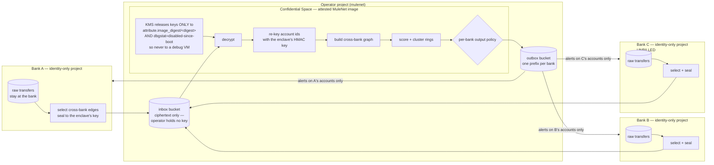

# How banks share without sharing

MuleNet's result depends on combining transaction structure across banks. The
first question any bank, regulator or judge will ask is the right one:

> **No bank can hand its customers' transactions to its competitors. So how
> would this ever be deployed?**

This page answers it. The **workload is now built and tested**; **none of the
Google Cloud side has been executed** — no KMS key, no attestation policy, no
Confidential VM. The status section at the end draws that line precisely, and
`docs/enclave.md` says what a credentialed run has to produce before any of the
attestation claims here may be repeated as fact.

## What actually has to be combined

Less than it sounds. The lift comes from the cross-bank features, and those
describe **edges between banks**, not full account histories:

- how many of an account's counterparties sit at *other* banks
- how many distinct banks it trades with
- whether money arriving from one bank leaves for another, and how fast

So the joint computation needs the cross-bank transfer graph — who paid whom,
across a bank boundary, when, and how much. It does not need names, KYC
documents, balances, or anything a customer did entirely inside one bank.

That matters: the hard part is not moving everything, it is moving the
cross-boundary edges without any single party being able to read them.

## The design: joint scoring in a Confidential Space enclave



**How it works:**

1. **Each bank keeps its raw data in its own custody.** Only transfers with
   **exactly one endpoint at that bank** are selected — an intra-bank transfer
   is nobody else's business, and the cross-bank features in `ml/features.py`
   do not use it. Names, balances, KYC documents and devices are never selected
   at all.
2. **Banks seal their edges to the enclave, not to each other.** Each bundle
   carries a fresh AES-256-GCM data key; only that 32-byte key is wrapped by
   Cloud KMS. The sending bank is bound into the AEAD, so relabelling a bundle
   breaks decryption rather than silently re-attributing the data.
3. **The ciphertext lands in an inbox bucket the operator owns** (see below for
   why), and the operator holds no key that opens it.
4. **KMS releases the key only to an attested image, on a machine nobody can
   look inside.** Two independent conditions, because either one alone leaves the
   operator holding the plaintext:
   - *The code.* The IAM binding names an attestation attribute rather than a
     service account: `attribute.image_digest/sha256:<digest>`. Change one line
     of the scorer, the digest changes, the rebuilt image is a different
     principal, and KMS refuses. Possessing the workload's service account is
     *not* enough.
   - *The machine.* The provider's condition requires
     `assertion.dbgstat == 'disabled-since-boot'` and a `STABLE` support
     attribute, so the key is refused to the `confidential-space-debug` image
     family — **which the operator can SSH into and read memory from.** Without
     this, an operator could run the blessed, correctly attested code on a VM it
     could read, and the promise below would be void. `docs/enclave.md` has the
     full condition and the two negative tests that check both halves.
5. **Identifiers are re-keyed inside.** Hashing happens in the enclave under a
   key KMS releases only to that image, so joinability stops coming from a
   secret every participant holds.
6. **Scoring happens inside**, over a graph no single party could assemble.
7. **Each bank receives alerts about its own accounts only.** Bank A learns
   that *its* account sits in a ring spanning three banks. It does not learn
   which accounts at Bank B are in it.

**Trust moves from people to code.** No bank has to trust another bank, or the
operator. They have to trust a published image and the hardware that attests to
it — which is auditable in a way that "we promise not to look" is not.

### Why the inbox is owned by the operator

The earlier version of this page had each bank hold its own encrypted store.
That needs a billable project per bank. The trial billing account is capped at
**five linked projects and is full**, and `mulenet-bank-c` is deliberately left
**unbilled**. So the banks became *identity-only*: a service account and nothing
billable.

The operator's blindness therefore rests on **key custody, not storage
custody**:

| party | can write inbox | can read inbox objects | can decrypt |
|---|---|---|---|
| a bank | its own prefix only (`objectCreator`, IAM condition) | no | no — `cryptoKeyEncrypter` only |
| the operator | — | yes, but it is ciphertext | no |
| the attested image | — | yes | yes, gated on its digest **and** on debugging being off |

`objectCreator` rather than `objectAdmin` is load-bearing: with `objectAdmin`
one bank could overwrite another bank's bundle and silently remove that bank's
accounts from the joint graph — which would let a bank hide its own mules from
the scoring.

**What this model costs, stated plainly:** the operator learns **traffic
metadata** — which bank uploaded, when, and how large the bundle was. It does
not learn contents. A deployment that cares about metadata puts the inbox in a
bank-owned or regulator-owned project; nothing else in the design changes.

## The key problem this design exists to fix

Today every account id in MuleNet is `HMAC-SHA256(key, raw_id)` with **one
shared key**, defaulting to `"demo-key"` (`simulator/config.py`). That is fine
for a simulator and wrong for production, and it is worth being precise about
why:

- **If each bank used its own key**, the same account would hash differently
  at each bank and cross-bank edges would never join. Detection would silently
  collapse to single-bank — and nothing would error.
- **If all banks share one key**, any bank holding it can hash a guessed
  account number and test whether that account appears in another bank's data.
  Account numbers are low-entropy, so a shared HMAC key is only as strong as
  the key's secrecy — and it has been handed to every participant.

The enclave resolves this by **never giving the key to any bank.** Hashing
happens inside, with a key KMS releases only to the attested image. Joinability
comes from the shared computation, not from a shared secret.

`enclave/rekey.py` implements this. The identifier is

    enclave_id = HMAC-SHA256(enclave_key, owning_bank_id || 0x1f || identifier)

with the **owning** bank bound into the input — which both banks on an edge
already agree on — so both derive the same id while neither can compute it.

**What that does and does not demonstrate**, because the difference matters:

- *It does* remove the shared key as the thing that makes the join possible. A
  bank can no longer hash a guessed account number and test whether it appears
  in another bank's data: it cannot compute `enclave_id` at all.
- *It does not* retroactively protect the existing data. The input is already
  `HMAC-SHA256("demo-key", raw_id)`, and `"demo-key"` is a public default in
  this repo, so anyone who wanted to enumerate account numbers against the
  demo-era hashes always could and still can. Re-keying protects the identifier
  space the enclave works in, going forward.
- *It is not yet* the production ingest path. There the bank would seal the
  **raw** identifier and the enclave would hash it once, making the demo key
  disappear entirely. The enclave half is built and treats its input as opaque,
  so it works unchanged the day the input becomes a raw id; the change to
  `simulator/` and `ingest/` is not done.

So Stage 4 retires the shared key *as the joining mechanism*. Saying it "retired
`demo-key`" without that qualification would overstate it.

## An alternative that needs no enclave: a regulator-hosted utility

There is a simpler model, and in India it may be the more realistic one.

**The regulator already sees cross-bank suspicion.** Under the Prevention of
Money-Laundering Act, reporting entities file Suspicious Transaction Reports
with FIU-IND — the Act's reporting and record-keeping duties are in this repo's
own regulation index. FIU-IND therefore already receives reports from every
bank; it is a party that is *permitted* to hold a cross-bank view.

MuleNet could run as a utility operated by the regulator or its innovation arm,
rather than as a consortium of banks trusting each other. RBI's own
mule-detection initiative, **MuleHunter.AI**, sits on the regulator side for
the same reason. What MuleNet would add to that model is specifically the
**cross-bank ring structure** — the span-2 and span-3 lift this repo measures.

The two models are not exclusive: a regulator could itself operate the
Confidential Space enclave, gaining attestation as an audit trail.

## What this does not solve

Stated plainly, because a design that hides its gaps is not a design:

- **Outputs leak.** An alert tells Bank A that one of its accounts is linked to
  accounts elsewhere. That is the point, but it is still information about
  other banks' customers, and the output policy needs legal review, not just
  engineering.
- **The legal basis is a legal question.** India's Digital Personal Data
  Protection Act, 2023 governs this processing and contains exemptions for
  preventing and detecting offences. Whether a bank consortium or a
  regulator-run utility falls within them is for counsel, not for this repo.
- **Attestation constrains the code and the machine, not the operator's other
  powers.** The operator still chooses when to run the enclave, which bundles are
  in the inbox, and whether to run it at all. It cannot read the data, and it
  cannot get the key onto a VM it can inspect, but "cannot read" is not "cannot
  interfere".
- **Attestation protects the code, not the model's judgement.** A correctly
  attested image can still produce a false positive. The deterministic verifier,
  and the rule that identity reuse is evidence only — never a basis for
  alerting — still apply inside the enclave.
- **Latency and cost change.** Confidential VMs cost more, and a join across
  three projects is not free. Neither has been measured.
- **The operator sees traffic metadata.** Which bank uploaded, when, and how
  big the bundle was. A consequence of the operator-owned inbox, explained
  above, and pinned by a test so it cannot quietly stop being acknowledged.
- **The outbox is now encrypted per bank, with one caveat.** Each bank
  generates an X25519 keypair offline (`infra/enclave_outbox_keygen.py`) and
  gives the enclave only its public key; the enclave seals each bank's alert
  bundle to that key before it ever reaches the operator-owned outbox bucket
  (`enclave/outbox_crypto.py`), so the operator holds ciphertext it cannot
  open. Verified live: the object on the wire is ciphertext, the receiving
  bank's own key decrypts it to the correct redacted bundle, and a different
  bank's key gets `InvalidTag`, not the data (`infra/enclave_read_outbox.py`).
  The caveat: nothing yet stops the operator from *substituting* a different
  ciphertext at that path before a bank downloads it — this closes read
  access, not tamper resistance, which would need the bank to verify a
  signature over the bundle, not built.
- **A bank could under-report.** Nothing forces a bank to send all its
  cross-bank edges, and a bank that omits an edge removes it from the joint
  graph. Attestation constrains the *enclave*, not the inputs. Detecting this
  needs something like a signed commitment to a row count, which is not built.

## What does one more bank actually buy?

**Code:** `ml/coalition.py` · **UI:** the control on the metrics tab ·
**Endpoint:** `GET /api/coalition`

Everything above argues that banks *can* join without handing each other data.
This section is the other half of the question a bank will actually ask: what
do I get for joining?

Everywhere else in this repo the answer is a **pair** of numbers — one bank
alone (`sb_`) against all three joined (`cb_`). A pair is two points. It cannot
show a curve, and "the network gets better as it grows" is a claim about a
curve. So `ml/coalition.py` measures the curve: every **coalition** of banks —
every subset — scored on what that coalition and only that coalition could
detect, averaged over all coalitions of the same size.

### The measured result

Ring recall, three real banks:

| banks joined | coalitions averaged | ring recall (shipped rule) | ring recall (spread clause dropped) | rings caught |
| --- | --- | --- | --- | --- |
| 1 | 3 | 0.0000 | 0.1278 | 0.0 / 120 |
| 2 | 3 | 0.6028 | 0.6028 | 72.3 / 120 |
| 3 | 1 | 1.0000 | 1.0000 | 120 / 120 |

**Read the second-to-last column before quoting the one before it.** The
shipped rule reads 0.0000 at one bank because its bank-spread clause
(`distinct_counterparty_banks >= 2`) is *uncomputable* inside a single bank —
in the `sb_` scope that feature is capped at 1 by construction, so the rule
fires on exactly zero accounts. That is the rule **declining to fire**, not one
bank seeing nothing worth firing on. `ml/rule.py` reports its own `single_bank`
variant the same way and for the same reason. The honest baseline is the
generous reading, 0.1278, and the honest headline is therefore
**12.8% → 60.3% → 100%**, not "0% → 100%".

### How a coalition's view is built

By deletion, not by a new code path. A coalition sees the accounts held at its
own banks and the transfers between them; everything else does not exist. That
view is produced by *filtering the tables* and handing them to the existing
`ml.features.build_features`, whose `cb_` scope over a two-bank world is exactly
"what those two banks see once they join". Nothing in `ml/` was modified — the
alternative was a visible-bank-set parameter threaded through
`_scope_features`, which would have put a second definition of scope next to
the one the published features use.

A transfer survives only when **both** endpoints sit inside the coalition. A
bank does see its own side of a payment to an outside account, but the
coalition cannot build a counterparty feature from an account it does not hold,
and pretending otherwise would let it read structure it has no access to.

### The metric, and what it is not

**Ring recall: the share of the dataset's true rings for which the coalition
flags at least one pass-through mule or collector.** Same definition as
`ml.early`'s `ring_recall`, with one deliberate difference — the flag is the
**velocity rule's** hard decision, not the XGBoost scorer's 1%-FPR operating
point. That is what makes sweeping every coalition cheap, and it means these
numbers are **not comparable** to the ring recall in `docs/claims.md`. The two
answer different questions and must not be read as one series.

The denominator is **every ring in the dataset**, including rings the coalition
holds no account in. Unconditional on purpose: a bank cannot act on a ring whose
members are all somebody else's customers, and moving those rings out of the
denominator would delete exactly the effect being measured. `rings_reachable`
is published beside it so the conditional reading is recoverable — and the gap
between `rings_reachable` and `true_rings_total` (120 true rings; detected
accounts cluster into 45 ring groups) is most of what joining buys.

### The fourth bank, and its honest limitation

The dataset has three banks. The toggle offers a fourth, and here is exactly
what it is: **half of `BANK_C`'s customers, relabelled `BANK_D`**, chosen by
hashing the account id. Every account, transfer, device and document is real
and unchanged. Only the `bank_id` label moves.

That is a real fourth bank in the one sense this measurement cares about — a
fourth independent visibility boundary over a real transfer graph. It is
emphatically **not** a fourth bank arriving with new customers and new money.
It redivides the same market. Two consequences, both published rather than left
for a reader to work out:

| banks joined | 3 real banks | 4 banks (`BANK_C` split) |
| --- | --- | --- |
| 1 | 0.1278 * | 0.0771 * |
| 2 | 0.6028 | 0.3250 |
| 3 | 1.0000 | 0.7250 |
| 4 | — | 1.0000 |

\* generous reading; the shipped rule is 0.0000 at N=1 in both worlds.

- Splitting a bank makes every individual bank **smaller**, so the `N = 1`
  baseline in the four-bank world is worse than in the real one. The 1-to-4
  gain is therefore **larger than a real fourth bank would produce**, and the
  bias runs in the flattering direction. That is why both curves are published
  and the page opens on the real one.
- For the same reason the four-bank world's `N = 3` point (0.7250) is **not**
  this repo's headline three-bank number (1.0000). It is three banks over a
  different partition. The gap between the two is the price of the split,
  quantified instead of asserted.

### Why it is precomputed, not live

The sweep is 22 feature builds over the full 572,890-transfer graph — about 50
seconds. That is an offline job, not a request. `GET /api/coalition` reads a
file and reshapes it; the control switches between numbers that were all
measured before the page loaded, and no request to the UI runs a detector.

That is also the only honest option. `infra/cloudbuild.ignore` excludes
`ml/experiments/` from the image and the deployed container has no
`simulator/out/` at all, so an endpoint that recomputed on demand would have
nothing to recompute from — and a number computed on demand from absent data is
a number invented on demand. A committed copy ships in
`ui/data/coalition_fallback.json`, guarded against drift by
`ui/test_fallback_sync.py` exactly like the other two fallbacks.

Regenerate with:

```bash
python -m ml.coalition        # needs simulator/out/; no model call, no GCP
python -m ui.build_snapshot   # refreshes the committed fallback
```

## Status

Built on branch `enclave-3bank`, then run for real against Google Cloud
(Stages 1-3 of `docs/enclave.md`'s runbook) once credentials were available.
Every row below marked **verified live** was confirmed from a GCS evidence
object or a direct read of the resulting bucket contents, not inferred from an
exit code — the standard this whole runbook holds itself to. Stage 4 (retiring
the shared demo HMAC key as the *joining* mechanism) is deliberately not run:
this is still a demo/competition build, not a production deployment, so the
cost of standing up per-bank KMS/billing for it is not worth paying yet.

| piece | state |
|---|---|
| per-bank GCP project (identity-only) | **verified live** — bank-a/b/c authenticate and write via impersonation, no downloaded keys (`infra/enclave_bank_identity.sh`) |
| Confidential Computing API | enabled on `mulenet` |
| enclave workload | **built** — `enclave/`, 93 tests passing, `--self-check` green |
| envelope encryption of edges | **built, tested, and verified live** (`enclave/envelope.py`) |
| per-bank outbox encryption | **built, tested, and verified live** (`enclave/outbox_crypto.py`) — see "What this does not solve" for the one remaining caveat |
| in-enclave re-keying (Stage 4) | **built and tested** (`enclave/rekey.py`); still keyed by the shared demo HMAC key as input, by design, until Stage 4 |
| three-bank join | **built, tested, and verified live** at real scale — 349,524 edges, 29,973 accounts (`enclave/graph.py`) |
| per-bank output policy | **built, tested, and verified live** — read each bank's real decrypted bundle and confirmed no foreign account id appears in it (`enclave/policy.py`) |
| KMS key-release policy | **created and exercised live** (`infra/enclave_pin_digest.sh`) |
| attested image | **built, pushed, and pinned by digest** multiple times as the workload was fixed |
| non-debug key release | **verified live** — evidence shows `dbgstat: disabled-since-boot`, `STABLE` present, `running_debug_image: false` on every successful run |
| evidence of a refusal | GCS evidence object, written on every run including refused and crashed ones; **exercised live** (including a crash-evidence path added and confirmed working this session) |
| negative test A (tampered code) | scripted + logic tested against a fake KMS; real refusal captured in Stage 1, prior to the runbook's live Stage 2/3 work |
| negative test B (debug VM) | scripted + logic tested against a fake KMS; real refusal captured in Stage 1, prior to the runbook's live Stage 2/3 work |
| encrypted cross-bank ingest | **run live** for all three banks (`infra/enclave_send_edges.py`) |
| unbilled-project write | **verified live** — `mulenet-bank-c`'s service account authenticated and wrote to the inbox with no billing enabled on its own project |

### What this needs from `shared/`

`shared/` is frozen and owned by the architect, so these were **not** made. Both
are recorded here rather than worked around:

1. **A `CrossBankEdge` wire contract.** A bank's contribution currently travels
   as `Account` + `Transfer` rows, because those exist. A dedicated contract
   would carry the owning bank of each endpoint, which `Transfer` has no field
   for (outside the enclave the two facts live in different tables).
2. **A `MembershipBasis` value for structural ring members.** The enclave finds
   accounts that *bridge* two flagged accounts across banks. They are neither
   `velocity` nor `identity_link` — and `identity_link` is validated to require
   `link_evidence_type`, the vocabulary of document and device reuse. Filing a
   transfer-graph bridge that way would attach a fabricated evidence claim to an
   account nobody flagged. So bridges are currently **dropped** from the emitted
   `Ring` and reported only as a count. Representing them honestly needs
   something like `cross_bank_structure`, alertable `False`, carrying no link
   fields.
3. **Flagged-account lists inside the sealed bundle.** Each bank names the
   accounts it flagged; that currently arrives as VM metadata, which is
   operator-visible (it is only a list of already-hashed ids, but it belongs in
   the bundle). The bundle schema is a `shared/` concern.
