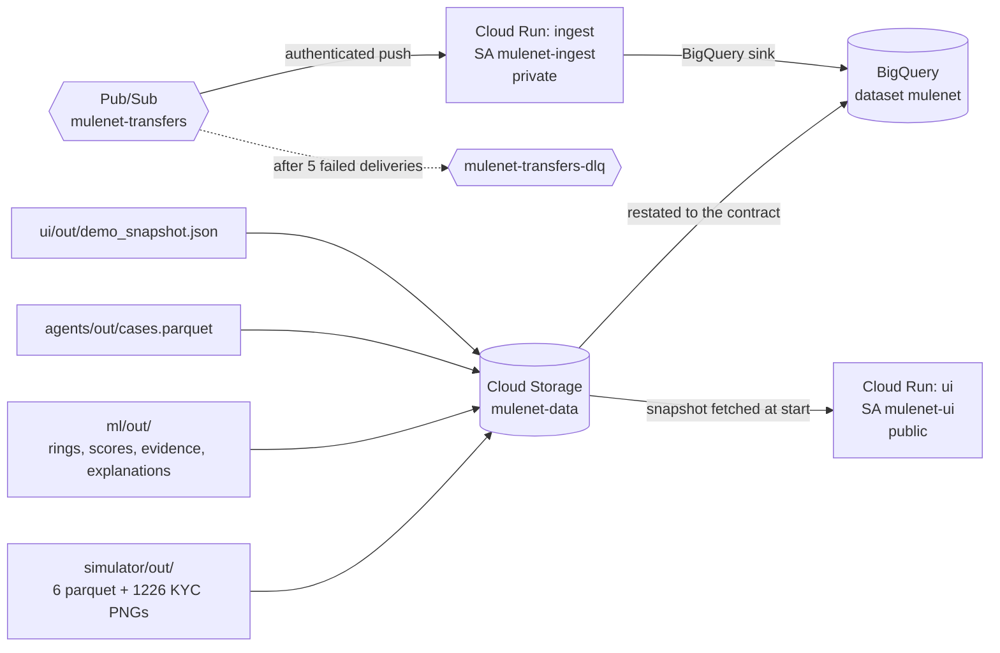

# MuleNet deployment

What runs in Google Cloud, what reads what, and the two things that are
deliberately **not** provisioned.

Scripts:

| Script | Runs | What it does |
|---|---|---|
| `infra/setup.sh` | once, already run | APIs, Artifact Registry repo, three least-privilege service accounts |
| `infra/deploy.sh` | every deploy | GCS bucket, BigQuery load, Pub/Sub, Cloud Run |
| `infra/cloudsql_deploy.sh` | **never run** | would provision Cloud SQL and load it |

---

## 1. Which service reads what

### Per service

**`ingest` (Cloud Run, private, SA `mulenet-ingest`)**
The only service that writes. Receives a Pub/Sub push at `/pubsub/push`,
validates the envelope against `shared/pubsub_schema.py`, and writes to
**BigQuery only**. Its operational (Postgres) sink is off — see §2.
A message that fails validation is parked on the dead-letter topic and
acked, so it is never redelivered in a loop.

**`ui` (Cloud Run, public, SA `mulenet-ui`)**
Reads exactly one file at request time: `demo_snapshot.json`, a pre-built
JSON bundle. It does **not** query BigQuery and does **not** read parquet
on the request path. `infra/fetch_data.py` downloads the snapshot from
the bucket at container start and verifies its md5 against the object, so
the UI serves the same published bytes that were loaded into BigQuery.
`ui/build_snapshot.py` — which does read parquet, from `simulator/out/`,
`ml/out/` and `agents/out/` — runs offline before the image is built.
`infra/deploy.sh` reruns it on every deploy (even with `SKIP_DATA=1`),
uploads the result and checks the object's md5 before deploying `ui`,
because new ui code over an old snapshot fails validation on ring pages.

**`agents` — not deployed.** See §4.

**`docai` — mock.** `MULENET_DOCAI_MODE` is unset and mock is the default,
so no Document AI processor is called and no API key exists.

### Secret Manager

Now genuinely in use. `mulenet-agents` reads two real secrets --
`mulenet-live-proof-key-bank-a` and `mulenet-live-proof-key-bank-b`, the
correct/wrong per-bank keys the live-proof demo decrypts an outbox
bundle with -- via Cloud Run `--set-secrets` (`infra/deploy.sh`). Access
is a per-secret `roles/secretmanager.secretAccessor` grant on each
secret (`gcloud secrets add-iam-policy-binding`, done out-of-band, not
scripted anywhere), not the broader project-wide role `setup.sh` once
granted and `infra/deploy.sh` now deliberately removes. The AlloyDB/
Cloud SQL DSN password this section used to say would be the first real
secret still does not exist, because no database is provisioned;
`infra/cloudsql_deploy.sh` is the first thing that would create one
(`mulenet-pg-password`, `mulenet-pg-dsn`).

### BigQuery tables

Loaded by `infra/load_bigquery.py` from `shared/bq_schemas.py`
`TABLE_SCHEMAS`, which is the contract:

| Table | Rows | Source |
|---|---|---|
| `transfers` | 572,890 | `simulator/out/transfers.parquet` |
| `scores` | 30,000 | `ml/out/scores.parquet` |
| `account_explanations` | 30,000 | `ml/out/account_explanations.parquet` |
| `account_evidence` | 649 | `ml/out/account_evidence.parquet` |
| `rings` | 45 | `ml/out/rings.parquet` |
| `ring_explanations` | 45 | `ml/out/ring_explanations.parquet` |
| `cases` | 45 | `agents/out/cases.parquet` |
| `features` | 0 | created empty; nothing publishes it yet — and no longer reachable from the agent's SQL tool |
| `str_reports` | 0 | created empty; nothing publishes it yet |

`features` was removed from `shared/tool_interfaces.py` `ALLOWED_SQL_TABLES`,
so `run_sql` now rejects it instead of running `SELECT ... FROM features` and
returning nothing. The only file of that name is `ml/features.parquet`, the
wide ML feature frame, which is missing 13 of the contract table's 15 columns;
allowlisted, it made an empty result look like a real answer. `shared/bq_schemas.py`
keeps `FEATURES_SCHEMA`, so `infra/load_bigquery.py` still creates the empty
BigQuery table through its `TABLE_SCHEMAS - SOURCES` branch — verified on this
deploy: that branch resolves to `['features', 'str_reports']`.

**Why the loader is Python and not `bq load`.** A Parquet load derives its
schema from the file, and `WRITE_TRUNCATE` deletes the table schema
outright — so the obvious one-liner silently replaces `TABLE_SCHEMAS` with
whatever pandas wrote, including the REQUIRED/NULLABLE modes and, for
`rings.members` and `account_explanations.top_factors`, the nested REPEATED
RECORD structure. Two concrete failures found while building this:

* pandas writes every column as optional, so the load was rejected with
  `Field transfer_id has changed mode from REQUIRED to NULLABLE`;
* `cases.closed_at` is an all-null column and Parquet types it as `null`,
  which cannot be read as a TIMESTAMP.

So the loader restates each published file against an Arrow schema derived
from `TABLE_SCHEMAS` (REQUIRED → non-nullable, REPEATED → list, RECORD →
struct, built recursively), then creates the table from the contract,
`TRUNCATE TABLE`s it (DDL that keeps the schema, unlike `WRITE_TRUNCATE`)
and appends. A null in a REQUIRED column now fails loudly at cast time
instead of loading quietly. The restated copies go to `bq_staging/` in the
bucket; the originals each module published are never overwritten.

`scores` gets two columns added before the cast. `SCORES_SCHEMA` is the
union of `RiskScore` and `GnnScore`, so it carries `model_type`
("xgboost or gnn") and `embedding_ref` ("null for the XGBoost baseline")
that the RiskScore-shaped `ml/out/scores.parquet` does not have.
`ml/out/manifest.json` records `validated_against` =
`shared.contracts.RiskScore` and `score_model_version` =
`mulenet-xgboost-cb-oof-v1`, so the discriminator is read from there.
Both values are the contract's own documented semantics — neither is
invented data.

---

## 2. Why Cloud SQL is not provisioned

The architecture in `CLAUDE.md` names AlloyDB as the operational store.
It is not provisioned, and `ingest` runs with **Pub/Sub and BigQuery only**.

**Cost.** It is the only always-on component in the design. Everything
else here scales to zero: Cloud Run at `--min-instances 0` bills nothing
idle, and GCS plus BigQuery storage for ~175 MB is cents per month. The
smallest sensible Cloud SQL instance runs continuously whether or not
anyone opens the demo, and would be roughly an order of magnitude more
than the entire rest of the stack combined (§6).

**Nothing in the demo path reads it.** The operational store exists for
row-by-row reads by a stable business key and for in-place updates by a
human. The demo does neither:

* the UI reads one JSON snapshot and never issues a query;
* the agents' `run_sql` runs against in-memory SQLite loaded from parquet;
* the agents' other tools read parquet through pandas;
* `ingest`'s analytical writes go to BigQuery.

So provisioning it would add the largest recurring cost in the project to
serve zero reads.

**What is kept ready.** Nothing is thrown away:

* `shared/ddl.sql` — the operational schema, unchanged;
* `ingest/sinks.py` `PostgresSink` — the idempotent writer
  (`INSERT ... ON CONFLICT (transfer_id) DO NOTHING`), which is what makes
  a Pub/Sub redelivery safe;
* `ingest/local_dev.py bootstrap-db` — applies the DDL and upserts accounts;
* `infra/cloudsql_deploy.sh` — written, reviewed, **never executed**. It
  provisions the instance, generates the password into Secret Manager,
  imports `shared/ddl.sql`, loads accounts through the existing loader, and
  repoints `ingest`. Its closing note records the one build change needed:
  the ingest image does not install `psycopg`, on purpose.

**The config flag.** `ingest/config.py` derives the operational sink
default from the environment, mirroring the `dlq_default` pattern already
in that file:

| Environment | `operational_sink` |
|---|---|
| local, no `MULENET_GCP_PROJECT` | `duckdb` |
| local emulator (`PUBSUB_EMULATOR_HOST` set) | `duckdb` |
| cloud (project set, no emulator) | **`noop`** |
| any, `MULENET_INGEST_OPERATIONAL_SINK=postgres` | `postgres` |

`deploy.sh` therefore sets nothing: Postgres is off in the cloud by
default, and the local emulator path that legitimately uses Postgres is
untouched. No dataclass field was added, because `ingest/test_sinks.py`
`make_config` constructs `IngestConfig` with every field named explicitly
and a new one would break all 16 of those tests. All 31 `ingest/` tests
still pass.

The ingest image also omits the `psycopg` driver. That is the belt to the
flag's braces: a misconfiguration fails at startup rather than writing to
a database nobody provisioned.

---

## 3. What switching the operational store on would require

Provisioning Cloud SQL is the easy half — run
`infra/cloudsql_deploy.sh`. Moving `run_sql` onto it is **not** a config
change, and this section is the honest cost.

`agents/run_sql` executes against **in-memory SQLite**
(`sqlite3.connect(":memory:")` with `PRAGMA query_only = ON`), tables loaded
from parquet per call. That is load-bearing, not incidental.

### 3.1 A dialect change

`agents/sql_guard.py` sets `DIALECT = "sqlite"` and uses it **twice**: it
parses the model's query as SQLite (`sqlglot.parse(query, dialect=DIALECT)`)
and re-emits the validated query as SQLite
(`safe.sql(dialect=DIALECT)`). The validator is not a pass-through filter —
it rewrites. Changing the engine changes what the guard parses *and* what it
emits, on both sides of the security boundary.

### 3.2 SQL function renames

The dialects are not compatible in the functions the agents actually use.
The live q05 answer used `json_array_length(banks_involved)` — a SQLite
JSON1 function, with **no BigQuery function of the same name**. It is not a
rename in one place either: it is advertised to the model in
`agents/prompts/analyst_qa.md` ("`json_array_length(col)` counts elements"),
asserted in `agents/test_live_fixes.py`, and referenced in
`agents/tools.py`. So a dialect switch means changing the prompt the model
is taught, the tool description it reads, and the tests that pin both.
`describe_tables` also advertises SQLite semantics to the model, so the
schema description the agent reasons over changes too.

### 3.3 Re-running every `sql_guard` attack test

This is the part that must not be skipped. `sql_guard` is a **security
boundary tuned to one dialect**: it is what stops a model-authored query
from writing, from reading outside the allowlist, or from stacking a second
statement. `agents/test_sql_guard.py` holds 23 test functions covering
roughly 60 adversarial cases (74 parametrized string literals) across:

* stacked statements
* write-CTEs
* qualified table names
* `sqlite_master` access
* over-limit queries

Every one of those cases is written against SQLite parsing. A case that a
SQLite parse rejects is **not** guaranteed to be rejected by a BigQuery or
Postgres parse — sqlglot's dialects differ in what they accept, how they
normalise identifiers, and what they treat as one statement versus two.
Until all of them are re-run and re-reasoned against the new dialect, the
guard's coverage is unknown, not merely reduced.

**So the order is: change the dialect, re-run all ~60 attack cases, fix
what the new dialect lets through, and only then point `run_sql` at the
database.** Provisioning first and switching the dialect later would leave
a validated-looking guard protecting a dialect it was never tested on.

---

## 4. Why there is no `agents` Cloud Run service

`deploy.sh` deploys `ingest` and `ui`. It does not deploy an agents API,
because there is nothing to deploy and nothing that would call it:

1. **`agents/` has no HTTP entrypoint.** It is a library plus a CLI.
   There is no `FastAPI` app, no `uvicorn` call and no `__main__` anywhere
   in `agents/` except `agents/eval/run_eval.py`. A Cloud Run service needs
   a server that listens on `$PORT`; none exists.
2. **The UI cannot talk to one.** `ui/chat.py` `build_backend()` returns
   `MockRouter` for `"mock"` and raises `NotImplementedError` for anything
   else: *"chat backend 'agents' is not wired yet; agents/ has not exposed
   the ADK router agent. Set MULENET_UI_CHAT_BACKEND=mock."* Deploying with
   `MULENET_UI_CHAT_BACKEND=agents` would crash the UI at startup.

Closing that gap means adding a server to `agents/` and an HTTP client
backend to `ui/chat.py` — two folders owned by other engineers, both
currently green. It is not an infra change and `infra/deploy.sh` cannot
work around it.

**Consequence to be explicit about:** the deployed stack does **not** call
Gemini on Vertex AI. The chat in the deployed UI is `MockRouter`, which
answers from the loaded snapshot — every number it gives is a number the
graph and case panel also show, but no model is invoked. `MULENET_AGENT_MODE`
and `GOOGLE_GENAI_USE_VERTEXAI` are wired into `agents/config.py` and the
`mulenet-agents` service account holds `roles/aiplatform.user`, so the
Vertex path is ready — it just has no server in front of it. Given that
`CLAUDE.md` requires Gemini on Vertex AI for the competition, this is the
gap to close first.

---

## 4a. Fixed: the probe is `/health`, never `/healthz`

**Cloud Run reserves `*.run.app` paths ending in `z`.** The Google Front
End answers `/healthz` with its own HTML 404 and the request never
reaches the container. Measured on the deployed UI while the route was
still called `/healthz`:

| Path | Result |
|---|---|
| `/api/overview` | `200`, app JSON |
| `/zzz-does-not-exist` | `404` `{"detail":"Not Found"}` — FastAPI's own 404 |
| `/healthz` | `404` Google's HTML error page — never reached the app |
| `/healthz/` | `307` — FastAPI redirecting, which proved the route existed |

Nothing was *broken* by it, because Cloud Run's default startup probe is a
TCP check on the container port rather than an HTTP GET. That is exactly
why it survived: the services started, served traffic and looked healthy,
while the endpoint they documented for checking health could not be
called from outside at all. Any external uptime check pointed at it would
have reported a permanently unhealthy service.

**All three services now serve `/health`** — `agents/`, `ui/` and
`ingest/`. Each carries a docstring saying why the name matters, and each
has a test asserting `GET /healthz` returns `404`, so the route cannot
quietly come back under the reserved name. `docs/agents_api.md` documents
`GET /health` as the contract.

The lesson generalises past this path: **a probe that is never called is
indistinguishable from a probe that always passes.** This one was wrong
for the whole life of the deployment, and no test or dashboard noticed,
because nothing outside the cluster ever asked it anything.

The fix is a one-word rename to a path not ending in `z` (`/health`), in
`ui/main.py` and `ingest/app.py`. Both are outside `infra/`, so this is
reported rather than changed.

---

## 5. Manual console steps

Almost nothing. For the record:

| Step | Automated? |
|---|---|
| Enable APIs | yes, `setup.sh` |
| Artifact Registry, service accounts, IAM | yes, `setup.sh` |
| GCS bucket + bucket IAM | yes, `deploy.sh` |
| BigQuery dataset, tables, loads | yes, `deploy.sh` |
| Pub/Sub topics, DLQ, push subscription, all IAM | yes, `deploy.sh` |
| Cloud Build image builds | yes, `deploy.sh` |
| Cloud Run deploys + public access | yes, `deploy.sh` |
| **Billing account link** | **no — console only** |
| **Budget alert** | **console, or a separate Billing-scoped API** |

**Billing** cannot be done from a project-scoped CLI call: linking a
billing account needs Billing Account Administrator on the billing account
itself, which lives outside the project. Console:
*Billing → My Projects → select `mulenet` → Change billing*. Already done
for this project.

**A budget alert** is worth adding by hand even though idle cost is near
zero, because it is the only thing that catches a mistake:
*Billing → Budgets & alerts → Create budget*, scope it to the `mulenet`
project, set a monthly amount and alert at 50/90/100%. This is
CLI-expressible via `gcloud billing budgets create`, but it needs the
billing account id and Billing Account Administrator, so it is deliberately
not in `deploy.sh` — a deploy script should not need billing-admin rights.

Everything else in the stack was created by script.

---

## 6. Idle cost

With no Cloud SQL, idle is effectively zero. Line items, us-central1,
on-demand list price:

| Item | Quantity | Idle cost |
|---|---|---|
| Cloud Run `ui` | `--min-instances 0` | **$0.00/day** — no instance, no billable time |
| Cloud Run `ingest` | `--min-instances 0` | **$0.00/day** |
| Cloud Storage (Standard) | ~175 MB published + ~100 MB `bq_staging/` ≈ 0.28 GB @ $0.020/GB-mo | ~$0.0056/mo → **~$0.0002/day** |
| BigQuery active storage | ~90 MB @ $0.020/GB-mo (first 10 GB free) | **$0.00/day** (inside the free tier) |
| Artifact Registry | 2 images ≈ 0.5 GB @ $0.10/GB-mo (first 0.5 GB free) | **~$0.00/day** |
| Pub/Sub | no messages published | **$0.00/day** (first 10 GB/mo free) |
| Secret Manager | 2 secrets (live-proof keys) | **~$0.004/day** (list price ~$0.06/secret-version/mo; not independently re-verified here) |

**Idle total: still well under $0.01/day (~$0.02–0.03/month), dominated by
Cloud Storage and Secret Manager.**

Non-idle, for contrast:

* BigQuery on-demand query is $6.25/TiB with the first 1 TiB/month free.
  Every table here is under 100 MB, so demo queries stay in the free tier.
* A Cloud Run request costs ~$0.000024/vCPU-s; the UI serves a cached
  snapshot, so a full demo session is fractions of a cent.
* Gemini 2.5 Flash on Vertex is not called by the deployed stack at all
  (§4), so its cost today is exactly zero.

**For comparison, the component deliberately not provisioned:** a
`db-g1-small` Cloud SQL instance is ~$0.035/hour plus ~$0.17/GB-month
storage — roughly **$25–27/month running continuously**, whether or not
anyone opens the demo. That is ~2,000× the entire current idle cost, to
serve zero reads on the demo path.
