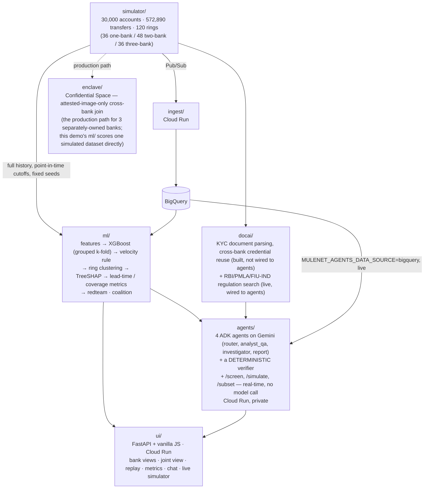

# MuleNet technical overview

The detailed version of the project README: architecture, every Google Cloud service,
limitations and lessons learned. The short, plain-English README is [`../README.md`](../README.md).


Money-mule rings move stolen money through accounts at several banks. Each
bank sees only its own fragment, so no single bank can see the ring.
MuleNet joins banks' views inside a hardware-sealed Google Confidential
Space enclave: banks catch the whole ring, and no one, not even the
operator, sees another bank's customers.

## Quick tour (5 minutes, for everyone)

1. **One bank's view** (Demo tab 1). A single bank sees part of a ring, and
   dead ends.
2. **The ring appears** (Demo tab 2). Join three banks and the full ring
   shows: source, mules, cash-out. Press *Play replay* to watch the money
   move.
3. **What joining buys** (coalition panel). Rings caught by the rule: 0%
   with 1 bank (it needs at least 2 by design), 60.3% with 2, 100% with 3.
4. **Run live proof** (Metrics tab, enclave card). Starts a real
   Confidential Space VM: attestation, then Cloud KMS releases the key; the
   wrong key fails (`InvalidTag`) and the right key decrypts. About 2–3 min.
5. **Try tampered code** (same card). An image with one line changed
   (`enclave/tamper.patch`) is refused by KMS with a real 403. Banks approve
   one exact code version, and the cloud enforces it, even against us.
6. **Gemini for investigators.** Click a ring, then *Report*: a
   suspicious-transaction report drafted by Gemini, citing real RBI, PMLA
   and FIU-IND pages (claims without evidence are removed). Use *Ask* for
   plain-English questions about the data or about Indian AML regulations;
   regulation answers show citation cards linking to the source PDFs.
7. **Score your own data** (subset tab). Upload one CSV per bank
   (`from_account,to_account,amount,timestamp,channel`); our trained model
   scores it live.

**Good to know**
- Live proof is capped at 10 runs per 24 hours (each run is a real paid
  VM). When the cap is reached, the card shows the most recent verified run.
- Data is synthetic: 30,000 accounts, 573,000 transfers, 120 true rings
  (detected accounts cluster into 45 ring groups).
- Headline results (Model A's 16-feature recipe, grouped 5-fold CV x 3
  seeds): ring recall 92.5% → 100% (single bank vs joined, at 3
  hours); false alerts per real catch 6.23 → 1.97 (at 5 minutes). Locked
  in `docs/claims.md`.
- Every panel names its detector: trained XGBoost Model A (16 features incl.
  identity signals), Model C (11 transfer-graph features, no identity
  signal, no account age, for uploads), or the rule. How much of Model A's
  accuracy traces to identity data specifically is measured in
  `ml/experiments/ablation/README.md`.
- Gemini drafted STR reports for all 45 detected ring groups in a batch
  run; the UI shows 24 of them — the 8 largest at each bank-span (1, 2 and
  3 banks), plus a few pinned edge cases (ambiguous matches, clusters
  matching no true ring). Every report needs investigator review before
  filing.
- Everything runs in `asia-south1` (Mumbai) now: Gemini (`gemini-3.5-flash`),
  the agents service, the web app, the data bucket and the BigQuery
  dataset. See `docs/residency.md` for how that move happened in two
  steps (inference first, data second) and `infra/asia_south1_migration.md`
  for the mechanics.

### Model features and detection rule

| detector | features | not included |
|---|---|---|
| **Model A** (16) | in/out-degree, unique in/out/all counterparties, distinct counterparty banks, amount in/out totals, pass-through ratio, pass-through speed, round-amount ratio, account age, device count, shared-device count, document-reuse count, document-reuse flag | — |
| **Model B** (12) | Model A's 11 transfer-graph features + account age | the 4 identity features (device/document reuse) |
| **Model C** (11, serves uploads) | Model B's 12 minus account age | identity features and account age — uploads carry no identity data |
| **Velocity rule** (the shipped detection logic) | fires when an account's in-degree ≥ **16**, out-degree ≥ **4**, `amount_out / amount_in` is within **0.1–2.0**, the pass-through hop takes ≤ **3,600 seconds** (1 hour), and the account touches ≥ **2** distinct banks | identity signals are never a firing condition — a shared device or reused ID only adds evidence to an already-fired alert |

Exact feature names, hashes, training provenance and verified call sites
for every model are in [`EVIDENCE.md`](EVIDENCE.md#1-models); the rule's
thresholds are `ml/rule.py`'s `VELOCITY_*` constants, the modal choice
across 15 tuning folds (`ml/tune.py`).

## Built on Google Cloud
**Live and on the serving path:** Gemini on Vertex AI, Vertex AI Search
(RBI/PMLA/FIU-IND regulation index), BigQuery (the agents service's data
source as of 2026-10-15 -- `accounts`, `transfers`, `rings` and 8 other
tables, behind `MULENET_AGENTS_DATA_SOURCE=bigquery`; a parquet fallback
still exists), Pub/Sub, Cloud Run, Confidential Space, Cloud KMS, Secret
Manager, Cloud Storage, Cloud Build, Artifact Registry.
**Live, but not yet on the serving path:** Vertex AI Model Registry (a
lineage record only, the model is not servable) and BigQuery's own
`features` table specifically (still not published, unlike the 9 tables
above).
**Built, not yet connected to the live app:** Document AI KYC parser
(validated offline on 50 synthetic documents).

## Hard questions, answered honestly

**Can we trust a synthetic dataset?** Real cross-bank data can't legally be
shared; that's the problem we solve. Our generator models known mule
patterns: fan-in collectors, 2–30 minute pass-through hops, shared devices
and reused documents, rings spread across banks. Hard-negative groups, like
busy small businesses, reproduce each signal legitimately, so no single
signal is enough. Scores are grouped out-of-fold (a ring is never scored by
a model that trained on it). You can also upload your own data. Real-world
accuracy is unknown until a pilot with real banks.

**Isn't the data designed to favour cross-bank detection?** Yes,
deliberately; cross-bank rings are the real-world gap. The hard negatives
keep the test from being trivial.

**Only 3 banks?** Nothing is tied to 3: the secure join, features and
per-bank keys work for any number of banks, and the rule only needs a ring
to touch at least 2. `ml/coalition.py` also tests a 4-bank world.
Validating with more banks is on the roadmap.

**What about rings that use banks outside the network?** We measured it:
with one of three banks missing, the rule still catches 60.3% of rings. The
visible accounts still show the pattern, and identity links can extend a
ring. Every bank that joins closes the gap.

**Can fraudsters evade it?** Yes, and we tested it ourselves. Gemini was
given the rule's exact thresholds and designed 3 evasions; all 3 beat the
rule and both trained models, which learn from the same features. (Tested
on isolated graphs against an attacker who knows our thresholds: the worst
case.) We tried adversarial retraining offline; it didn't hold up under
scrutiny (see Known limitations). Robust retraining and harder-to-fake
signals are next.

**Why XGBoost, not a graph neural network?** We built a GraphSAGE GNN and
found it saw test accounts' structure during training, which inflated its
scores. We disclosed that rather than ship it. XGBoost is explainable,
honestly evaluated and servable live.

**Why is the upload model weaker early on?** Uploads contain only
transfers, no identity data. Without identity signals, early detection
drops sharply (PR-AUC 0.62 → 0.24 at 5 minutes): direct evidence that
safely sharing identity signals across banks matters.

## Roadmap (not production-ready yet)
Retire the shared demo hashing key · tamper-proof enclave outputs · DPDP
Act review · zero-day anomaly detection · connect the Document AI KYC
parser · what drives detection (identity, then account age, then
nothing) · an IBM public-benchmark sanity check · a modest, unshipped
GNN + XGBoost gain · adversarial retraining as a defence (tried,
inconclusive) · flat false alerts as more banks join · a real-data pilot
with real banks.

---

## The headline result

**Coverage** — the share of *all* rings flagged at a measured horizon
**before the money reached the exit account**. Not "flagged eventually": a
flag after cash-out is a detection, not a save.

| ring spans | single-bank | cross-bank | Δ |
|---|---|---|---|
| 1 bank (36 rings) | 0.935 | 0.926 | **−0.009** |
| 2 banks (48 rings) | 0.826 | 1.000 | **+0.174** |
| 3 banks (36 rings) | 0.787 | 0.944 | **+0.157** |
| all 120 | 0.847 | 0.961 | +0.114 |

3-seed mean (42, 43, 44), out-of-fold. **Read the first row first**: a ring
wholly inside one bank is already fully visible to that bank, so pooling
should buy nothing — and it buys slightly less than nothing. That negative
control is why the +0.174 and +0.157 are believable: the effect appears
exactly where the data is fragmented, and is absent where it isn't.

Same gradient in PR-AUC at T=5m: **+0.0085 / +0.1740 / +0.3279** for spans
1/2/3 (the span-1 figure is noise, not signal — its per-seed deltas flip
sign; spans 2 and 3 are positive on every seed). Ring recall at T=180m:
**1.000 cross-bank vs 0.925 single-bank**. Alert burden at 80% recall:
**6.23 → 1.97** false alerts per catch.

**The advantage is coverage, not speed.** Among the 112 rings both scopes
catch, 90 tie at the same horizon (median lead: 0.0 minutes). Cross-bank
catches rings single-bank never catches in time at all — not the same rings,
sooner.

Every quotable number here is generated into [`docs/claims.md`](claims.md)
with its source key path, and a test fails if any of them drifts from
`ml/experiments/*/metrics.json`.

For a verifiable ledger of every model file, experiment, branch and merge in this repo (hashes, commit dates, reproduce commands), see [`docs/EVIDENCE.md`](EVIDENCE.md).

## Architecture



**Why `ml/` reads `simulator/` directly instead of through Pub/Sub and BigQuery.**
The Pub/Sub → `ingest/` → BigQuery path exists to show how a live system would
ingest transfers arriving one at a time. `ml/`'s job is different: for every
account it needs the complete history up to a precise per-account cutoff,
computed under two scopes (single-bank and cross-bank) and repeated across
many horizons and random seeds for grouped cross-validation (see
`ml/features.py`'s point-in-time-correctness rules). That is a batch read over
the whole table at specific instants, not a query a streaming pipeline is the
right shape for -- so the training/evaluation pipeline reads the published
parquet directly, and the streaming path stays a separate, real demonstration
of production-style ingestion rather than training's actual data source.

**Detection is decided by velocity and structure. Identity reuse is evidence
only.** A shared device or a reused ID number never causes an alert; it
qualifies one. Cross-bank identity links are alertable, same-bank links are
published as context — enforced in the `RingMember` contract, the verifier's
wording rules, and the UI's rendering, because a system that alerts on a
shared phone alerts on families.

**The verifier is deterministic, not an LLM.** Python re-derives every
numeric claim in a narrative from tool data, and a claim that fails withholds
the whole investigation. An early run without this produced five confident
regulation citations the search tool had never returned — an LLM checking
its own arithmetic is weaker than recomputation.

## Google Cloud services actually used

Listed as deployed, not as aspired to.

| service | what it actually does | limits |
|---|---|---|
| **Vertex AI — Gemini 3.5 Flash** | the four ADK agents, `asia-south1`; ~$0.0039/question measured | the only Gemini 3.x model served in `asia-south1`; `gemini-2.5-flash` retires 16–20 Oct 2026 |
| **Vertex AI Search** (Discovery Engine) | live regulation index over 4 official PDFs (825 pp), extractive segments with page numbers; every citation carries title, page and the authority's URL | `global` only — no `asia-south1`; corpus is Indian statute, so it returns nothing for fan-in / pass-through typology language |
| **Document AI** — Form Parser v2.0, `asia-south1` | KYC field extraction on 50 synthetic documents: address 50/50, document number 48/50, name 46/50; $0.0301/doc | all 6 failures were one character (`O` for `0`); no generic identity parser offered in-region |
| **Vertex AI multimodal embeddings** | cross-bank document reuse; separates the dHash's colliding pair (0.99551 vs 0.99748 max-unrelated) | headroom is 0.0025 of cosine; measured on 1,225 pairs, not established at the 7.5M-pair corpus scale |
| **Vertex AI Training** (custom job) | the canonical `ml.early` + `ml.leadtime` run, `n1-standard-4`, `asia-south1`, 13m03s, ~$0.05 | local remains the source of truth — the cloud run doesn't reproduce local bit-exactly (below) |
| **Vertex AI Model Registry** | `mulenet-xgboost-cb-oof-v1`, alias `local-canonical-20260927` | a lineage record, not an endpoint — `servable: false`, five per-fold boosters are not one servable model |
| **Vertex AI Experiments** | 17 params, 26 metrics per run, incl. `gate_verdict` | the run carries its own failed-gate verdict, not authoritative alone |
| **Cloud Run** | 3 services: `mulenet-ui`, `mulenet-agents` (private, ID-token auth), `mulenet-ingest` | agents must run `--max-instances=1`; its rate limits are in-process |
| **Cloud Build + Artifact Registry** | images per service per region | builds need the `mulenet-build` service account |
| **Pub/Sub** | transfer stream into `ingest/`, with a DLQ | |
| **BigQuery** | 14 tables from `shared/bq_schemas.py`; 10 of them are the agents service's live data source (`MULENET_AGENTS_DATA_SOURCE=bigquery`, loaded once at warm-up via `agents/data.py`'s `_load_from_bigquery`) | `features` is created empty — nothing publishes it; needs `roles/bigquery.dataViewer`, `jobUser` and `readSessionUser` on the agents service account, the last one easy to miss since `google-cloud-bigquery-storage` needs it only at query time, not at import |
| **Cloud Storage** | data snapshot; `asia-south1` mirror for the agents service | mirror cut agents cold start 49s → 9s |
| **IAM** | per-service accounts, least privilege, service-to-service ID tokens | |
| **Confidential Space** | enclave joins 3 banks' data for cross-bank clustering; KMS releases the key only to one attested image digest | Stages 1–3 verified live against evidence, not exit codes: self-check, both negative tests, a real 3-bank join (349,524 edges), and per-bank outbox alerts now encrypted to each bank's own offline-generated key. Stage 4 (retiring the shared demo HMAC key) intentionally deferred — this is a demo build, not production. See [`docs/enclave.md`](enclave.md) and [`docs/data_sharing.md`](data_sharing.md) |

**Cloud training vs local:** the Vertex job's data path is bit-identical to
local — same cutoffs, positives, row counts. Only the XGBoost *fit* moves,
because the same package version is a different compiled binary on
`win_amd64` (local) vs `manylinux` (container). Every published number comes
from the local run; conclusions are gated to reproduce across platforms, not
demanded to match byte-for-byte.

**Not used, deliberately:** Cloud SQL / AlloyDB are unprovisioned — the DDL
and an unrun `infra/cloudsql_deploy.sh` are kept; see `docs/deployment.md`.

## How banks would share this without sharing it

The obvious objection is the right one: **no bank can hand its customers'
transactions to its competitors.** Full design in
[`docs/data_sharing.md`](data_sharing.md); in short:

- The lift comes only from **cross-bank edges** — who paid whom across a bank
  boundary — never full account histories.
- Each bank encrypts those edges to a **Confidential Space enclave**, not to
  each other. KMS releases the key only to an attested MuleNet image, and
  each bank gets alerts about **its own accounts only**.
- Today every id is hashed with one shared HMAC key — a bank-c bundle proves
  the enclave will refuse a bank that tries to poison or misattribute another
  bank's data (see `docs/enclave.md`).
- A simpler alternative: a regulator-hosted utility. FIU-IND already receives
  Suspicious Transaction Reports from every bank under PMLA, so it's already
  a party permitted a cross-bank view.

## Reproduce

Python 3.11. Everything is seeded; seed 42 is canonical.

```bash
py -3.11 -m venv .venv && .venv/Scripts/activate   # or bin/activate
pip install -e ".[dev]"

python -m simulator.generator          # 30k accounts, 572,890 transfers
python -m ml.early                     # horizon sweep, writes the OOF store
python -m ml.leadtime                  # coverage and lead-time metrics
python -m ml.publish_all               # the ONLY supported way to build ml/out
python -m ml.claims                    # regenerate docs/claims.md
python -m ml.coalition                 # ring recall per coalition of banks
python -m pytest                       # whole suite, offline and free
```

`ml.coalition` is what the **"what does one more bank buy?"** control on the
metrics tab reads: ring recall goes **0.128 → 0.603 → 1.000** as one, two and
three banks join. Read [`docs/data_sharing.md`](data_sharing.md) before
quoting it — in particular why the shipped rule reads 0.000 at one bank.

One more command, and the only entry point here that calls a model:

```bash
MULENET_AGENT_MODE=vertex python -m ml.redteam   # Gemini attacks the detector
```

Gemini is given the detector's own thresholds and asked for transfer patterns
that stay outside them; each pattern is then run through the real rule and
clustering. A miss is a valid, useful result — see
[`docs/redteam.md`](redteam.md) for what a verdict does and doesn't mean.

The suite makes **no model calls**. `MULENET_REQUIRE_OOF=1` (set this in CI)
turns "artefact missing → skip" into "artefact missing → fail".

**Deployment:** `infra/deploy.sh` (requires `PROJECT_ID`, `REGION`,
`AGENTS_REGION`). See [`docs/deployment.md`](deployment.md).

## Data residency

**Everything runs in `asia-south1` (Mumbai) now — inference and the data
both.** Gemini inference moved first, because `asia-south1` was the only
region serving `gemini-3.5-flash`, the model actually used today. The GCS
bucket, BigQuery dataset, and `ui`/`ingest` services moved second, closing
the gap a storage-residency requirement would have cared about: moving
inference alone relocates where a prompt is *processed*, not where records
are *stored*, and only the second step addresses that. Full history and
probe matrix in [`docs/residency.md`](residency.md); the new
resource names and deploy script are in
[`infra/asia_south1_migration.md`](../infra/asia_south1_migration.md).

## Regulation corpus

`docai/` cites regulations in the compliance reports it drafts, from 4
official Government of India PDFs (RBI KYC Master Direction, PMLA 2002, PML
Rules 2005, FIU-IND Reporting Format) — not committed here, gitignored, and
reproducible. Fetch instructions, checksums and the RBI cold-connection
workaround are in [`docs/regulation_corpus.md`](regulation_corpus.md).

These four PDFs are the live Vertex AI Search index. A citation is verified
by **retrieval identity** — `search()` records every citation it returns,
and a citation retrieval never produced cannot verify, even if the source
document is genuinely indexed.

## Limitations

Stated plainly, because a demo that hides these is worse than one that
doesn't work.

- **The data is synthetic.** Every number here describes a simulator we
  wrote. `docs/post_submission.md` lists that world's artefacts. None are
  production estimates.
- **`verified` is always `false` on chat answers.** `analyst_qa` returns
  prose, not typed claims, so there's nothing to re-derive. Badges appear
  only on investigations, where claims really were re-derived.
- **Ring-level recall is capped by clustering, not detection.** 87.8%
  account-level recall collapses to 44% ring-level: a flagged mule only
  joins a ring when its counterparty is also flagged.
- **7 of 45 detected clusters span more than one true ring.** The UI labels
  these ambiguous and names how many true rings each contains.
- **Only 44 of 120 true rings are reachable in the UI** — the rest were
  never clustered.
- **The regulation corpus has a coverage gap.** It's Indian statute and
  reporting-format text; it contains no fan-in / pass-through *typology*
  language, so 2 of 4 live report queries return zero passages. A report
  drops the grounds it can't cite, honestly.
- **Rate limits are in-process**, so the agents service must run with
  `--max-instances=1`.
- **Every shipped detector is supervised.** The velocity rule and both
  trained XGBoost models are tuned or trained against this dataset's
  labelled pass-through pattern; none of them is built to recognise a
  fraud pattern that looks nothing like that label set. An unsupervised
  Isolation Forest was built and measured against one designed stress
  pattern (`docs/claims.md`'s "Slow-drip stress test"): it beat the rule
  single-bank (41.7% vs 10.8% ring recall) but trailed XGBoost everywhere
  by double digits, and it is not deployed. That one experiment measures
  performance on a pattern the team designed, not on fraud nobody
  anticipated -- the underlying limitation stands. (`ml/experiments/slow_drip/`.)
- **Red-team retraining (offline, not deployed).** Three Gemini-designed
  evasions of the velocity rule evaded the rule, Model A and Model B.
  Retraining a copy of Model A on self-generated evasions looked like it
  caught held-out strategies, but the retrained model also flagged most
  benign synthetic accounts, so the result is inconclusive -- dominated
  by a synthetic-data artifact, not evidence of robustness. Robust
  adversarial retraining, with synthetic traffic embedded in the real
  graph, is future work. (`exp/adversarial` branch,
  `ml/experiments/adversarial/README.md`; baseline evasion results in
  `ml/experiments/redteam/model_comparison.json`.)

## What went wrong, and what it taught us

Every item here was a real defect, found by measuring rather than reasoning.
Recorded because the failures were more instructive than the successes, and
because most of them were **checks that reported success while measuring
nothing**.

### Checks that couldn't fail

- **A probe nobody could call.** All three services exposed `/healthz`.
  Cloud Run reserves `*.run.app` paths ending in `z` and answers them with
  its own HTML 404 — the request never reached a container, for the entire
  life of the deployment, and nothing noticed because the startup probe is a
  TCP check. *A probe that is never called is indistinguishable from a probe
  that always passes.* Now `/health`, with a test asserting `/healthz` still
  404s.
- **Three builds reported `exit code 0` while all three had failed.** The
  code came from a trailing `tail` in the command chain, not `gcloud`. Since
  then: verify against the registry, bucket or API response, never the exit
  status. The same bug recurred in this project's own test-harness scripts
  today — a stale local cache reported an enclave negative test's *previous*
  failed result instead of its current, correct one.
- **A catalogue listing is not a capability check.** `models.get` returned OK
  for every Gemini 3.x model in every region; `generate_content` 404'd on
  most of them.
- **A provenance collector that could never record anything.** `sources`
  came back empty on every live answer. ADK invokes tools on a bare
  `threading.Thread`, which starts with a fresh empty context, so a
  `ContextVar` collector never saw them — *instrumentation cannot report on
  its own failure.* 46 tests passed alongside it because the fakes called
  tools inline, and one test had asserted the empty result as correct
  behaviour.

### Verification that verified nothing

- **Re-searching to confirm a search is circular.** `verify_citation()` used
  the citation string as a query and required an exact match. On 825 real
  pages, *"PMLA, 2002, p. 14"* carries almost no signal about page 14's
  content, so all four real citations failed. Fixed by verifying against
  **retrieval identity** instead of re-querying.
- **A stale prompt actively taught fabrication.** `prompts/report.md` still
  called the corpus a placeholder after it went live, so the model invented
  placeholder-shaped citations instead of retrieving real ones.

### Numbers that don't survive scrutiny

- **A headline metric that measured the horizon grid, not the detector.**
  `share_caught_before_exit` equalled ring recall exactly at T=5m and was
  structurally 0.0000 at T=180m where recall was 1.0000. Retired.
- **A mean carried by one seed is not a finding.** The span-1 PR-AUC
  gradient reads +0.0085; its per-seed deltas flip sign. Reported as zero.
- **Bit-exact across platforms is not a reasonable thing to demand.** Same
  XGBoost version, different compiled arithmetic on Windows vs Linux. We
  gate conclusions across platforms, and bytes only within one.

### Documentation decays into untruth

Several statements here were accurate when written and became false as the
system improved — `/healthz` as a "known issue" after it was fixed, the
regulation corpus as "placeholder" after it went live, the enclave as
"designed, not built" after it ran and passed on Google Cloud. `docs/claims.md`
is generated and drift-tested for numbers; prose is re-checked whenever the
thing it describes changes — this README's Architecture and Google Cloud
sections were both updated today for exactly this reason.

### One we chose not to take

Six of fifty Document AI extractions failed on a single character (`O` for
`0`), and a two-line normaliser would have taken all three fields to 50/50.
We didn't ship it: production only reads the address, already 50/50, and a
corrector that only improves a number the same module reports is marking
your own homework.

## Repo layout

| path | contents |
|---|---|
| `shared/` | contracts: pydantic models, SQL DDL, BigQuery schemas |
| `simulator/` | synthetic 3-bank data and KYC documents |
| `ingest/` | Pub/Sub publisher and Cloud Run consumer |
| `ml/` | features, models, rings, explanations, metrics, red-team, coalition |
| `docai/` | KYC parsing and document reuse detection |
| `agents/` | ADK agents, tools, prompts, verifier, eval, HTTP service |
| `ui/` | FastAPI + frontend |
| `enclave/` | Confidential Space workload — cross-bank join, no plaintext ever leaves it |
| `infra/` | setup, deploy, Dockerfiles, BigQuery loader, enclave scripts |
| `docs/` | claims ledger, deployment, residency, API contract, enclave runbook, backlog |

No secrets, no keys, no real data. Account identifiers are HMAC-hashed
everywhere, including in logs.

## Licence

[Apache License 2.0](../LICENSE).
