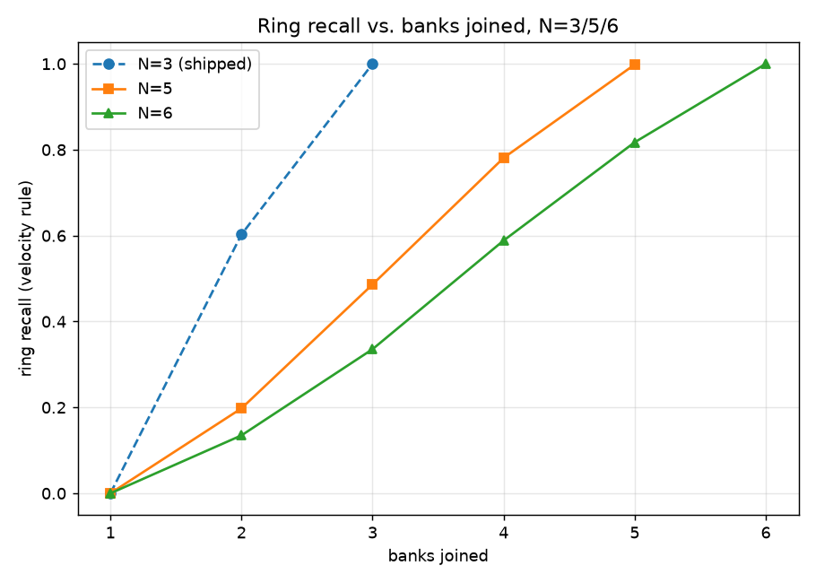

# Does the cross-bank advantage hold with more than 3 banks?

**Test only. Never touches the production dataset, the live app, the
trained models, the UI, or `docs/claims.md`.** Generates its own
synthetic N-bank worlds under `ml/experiments/n_banks/data/` and reports
on those alone.

## Method

`generate_and_sweep.py` monkeypatches `simulator.generator.BANKS` to a
5- or 6-bank tuple for the duration of one `generate()` call, then
restores it — **no edit to `simulator/generator.py` itself**. The
world is then swept with `ml.coalition.sweep()`, the same ring-recall-
by-coalition-size sweep the shipped 3-bank world uses, unmodified.

## Comparability choices

- **`accounts_per_bank = 10,000`**, same as the shipped world. Each
  bank's own local population stays the same size regardless of N, so
  a "does joining help" comparison isn't confounded by also changing
  how much each bank can see on its own.
- **`rings_per_pattern` scaled with bank count** to hold the mule
  *share* of the population constant as the total account count grows:
  ×5/3 for N=5 (50/pattern, 200 rings total), ×2 for N=6 (60/pattern,
  240 rings total). The shipped world is 30/pattern, 120 rings total.
- **Span distribution left at the shipped `(0.30, 0.40, 0.30)`** over
  spans 1-3 banks — this is the **primary variant**. A ring's span
  (how many banks it touches) is capped at 3 either way; what changes
  with N is *which* banks out of the larger pool a ring draws from.
  This required no code change at all:
  `simulator/generator.py`'s `rng_ring.choice(n_banks, size=span,
  replace=False)` already draws from every bank in `BANKS`, not just
  the first three. The bell-shaped-span-over-1..N second variant was
  not built — the primary variant alone already answered the question
  cleanly enough that the extra variant wasn't needed to reach a
  conclusion, and time was better spent confirming the primary result
  across more seeds.
- **3 seeds per world: 42, 43, 44** — the same three seeds the shipped
  3-bank pipeline's `docs/claims.md` numbers are averaged over.

## Results

Mean ring recall (velocity rule, shipped thresholds unmodified) by
coalition size, 3-seed mean:

| banks joined | N=3 (shipped) | N=5 | N=6 |
|---|---|---|---|
| 1 | 0.0% | 0.0% | 0.0% |
| 2 | 60.3% | 19.8% | 13.5% |
| 3 | 100% | 48.6% | 33.6% |
| 4 | — | 78.1% | 58.9% |
| 5 | — | 99.8% | 81.7% |
| 6 | — | — | 100% |



Each row is a **mean over every combination of that many banks** --
e.g. "2 banks joined" at N=5 averages all `C(5,2) = 10` two-bank
coalitions, the same convention `ml.coalition.by_size()` already uses
for the shipped N=3 world (3 combinations there). It is not one
specific pair of banks.

**The core finding replicates: recall rises monotonically with every
bank that joins, reaching 100% once every bank in the world has
joined, for N=5 and N=6 exactly as it does for N=3.** The join effect
is not a 3-bank artifact.

**What does *not* replicate at face value: recall at the same *number*
of banks joined is lower for larger N** — e.g. 2 banks joined is 60.3%
at N=3 but only 19.8% at N=5 and 13.5% at N=6. This is expected, not a
regression: a ring spans at most 3 banks regardless of N (the span
distribution was held fixed on purpose, see above), so as the bank
pool grows, a random same-size coalition is proportionally less likely
to happen to include all of any given ring's few specific banks. Read
by **fraction of banks joined** instead, the dilution is much smaller
(2/3 of 3 vs. 2/5 of 5 vs. 2/6 of 6), and the shapes track each other.
This is a property of the chosen comparability variant, not a property
of the detector.

## False alerts — flattening, not rising

Flagged accounts per ring caught, at full join (every bank joined,
mean of 3 seeds):

| N | flagged accounts | rings caught | flagged / caught |
|---|---|---|---|
| 3 (shipped) | 676 | 120 | 5.63 |
| 5 | 1062.0 | 199.7 | 5.32 |
| 6 | 1266.3 | 240.0 | 5.28 |

**Flat to mildly improving, not rising**, as N grows from 3 to 6 at
full join. The same ratio at partial join sizes is lower still (e.g.
~2.3-2.9 at 2 banks joined for N=5/6) and also does not show a rising
trend with N. This experiment did not re-derive a true/false-positive
split against ground truth (only `flagged_accounts` and `rings_caught`
are available from `ml.coalition.CoalitionResult` without extra
instrumentation) — this ratio is a proxy for alert burden, not an
exact false-positive count, and is reported as such.

## Does the flattening hold with hard negatives scaled too?

The results above used the shipped hard-negative cohort sizes
(`n_businesses=50`, `n_families=200`, `n_dual_bank=200`) at every N --
flagged in Limits (below) as untested. Re-run with those three scaled
by the same ratio as `rings_per_pattern` (x5/3 for N=5, x2 for N=6), 3
seeds each, in `data/n{N}_seed{seed}_hn/` and `results_hn.json` (the
unscaled run above is kept on disk, not overwritten).

**Ring recall is unchanged** -- identical to the table above, seed for
seed. Expected: `ring_recall` only counts true rings caught, and hard
negatives are never part of a true ring by construction, so scaling
them cannot move this number.

Flagged accounts per ring caught, at full join, hard negatives scaled:

| N | flagged accounts | rings caught | flagged / caught (scaled) | flagged / caught (unscaled) |
|---|---|---|---|---|
| 3 (shipped) | 676 | 120 | 5.63 | 5.63 |
| 5 | 1090.7 | 199.7 | **5.46** | 5.32 |
| 6 | 1313.0 | 240.0 | **5.47** | 5.28 |

**The flattening holds, and tightens slightly.** With hard negatives
properly scaled, the ratio at full join is 5.63 / 5.46 / 5.47 for
N=3/5/6 -- closer together than the unscaled run's 5.63/5.32/5.28, and
still not rising. The partial-join ratios (e.g. 2.60-3.12 at 2 banks
joined) move the same small amount and tell the same story. Scaling
the hard-negative cohorts does not change the conclusion.

## Limits

- **Velocity rule only.** `ml.coalition.sweep()` is rule-based; no
  trained model was swept here. Grouped out-of-fold XGBoost at T=5m/
  T=180m was in scope if time allowed and was not reached within the
  session's timebox — the rule sweep alone already answered the
  comparability question this experiment was built to ask.
- **Bell-shaped span-over-1..N variant not built** (see above) — the
  primary variant's result was clean enough that it wasn't needed.
- **3 seeds, not more.** Matches the shipped pipeline's convention;
  the per-seed spread shown in `results.json` is narrow (recall std
  under 1pp at every coalition size checked), so 3 seeds look
  sufficient here, but this wasn't independently re-verified at a
  larger seed count.
- **Hard-negative scaling checked once, not swept.** Scaling
  `n_businesses`/`n_families`/`n_dual_bank` by the same ratio as
  `rings_per_pattern` (see above) didn't change the conclusion, but
  only that one ratio was tried -- a different scaling rule was not
  swept to check this isn't a coincidence of this particular choice.
- **This is a test-only branch artifact.** Nothing here is wired into
  `ml/coalition.py`, `docs/claims.md`, the UI, or the shipped dataset.
  `python -m ml.experiments.n_banks.generate_and_sweep` is the only
  entry point, and it writes only under this directory.

## Reproduce

```bash
python -m ml.experiments.n_banks.generate_and_sweep
```

Idempotent per world/seed (skips regeneration if
`data/n{N}_seed{seed}/ground_truth.parquet` already exists). Writes
`results.json` in this directory; does not touch `simulator/out`,
`ml/out`, or anything outside `ml/experiments/n_banks/`.

Set `SCALE_HARD_NEGATIVES = True` in `generate_and_sweep.py` (the
module constant near the top) to run the hard-negative-cohort-scaled
variant instead -- writes to `data/n{N}_seed{seed}_hn/` and
`results_hn.json`, alongside the unscaled run rather than overwriting
it.
