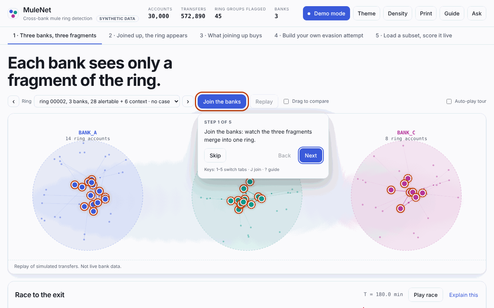
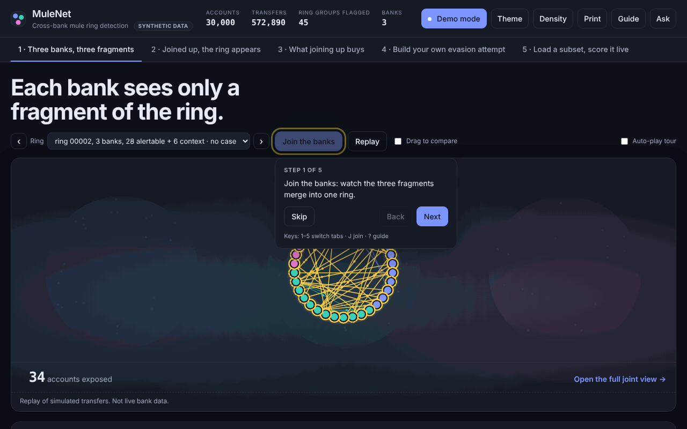
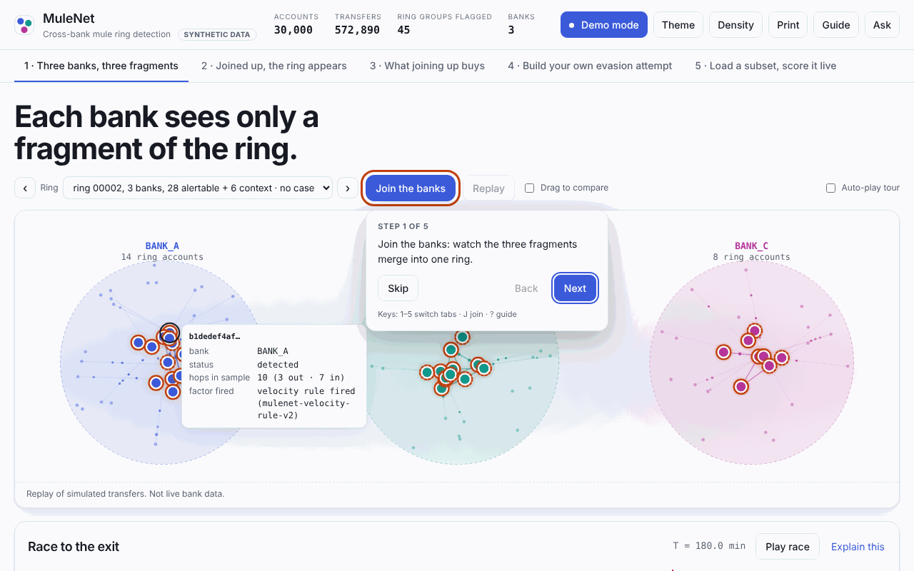
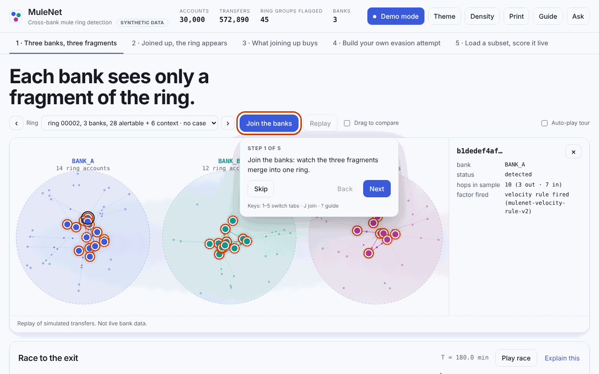
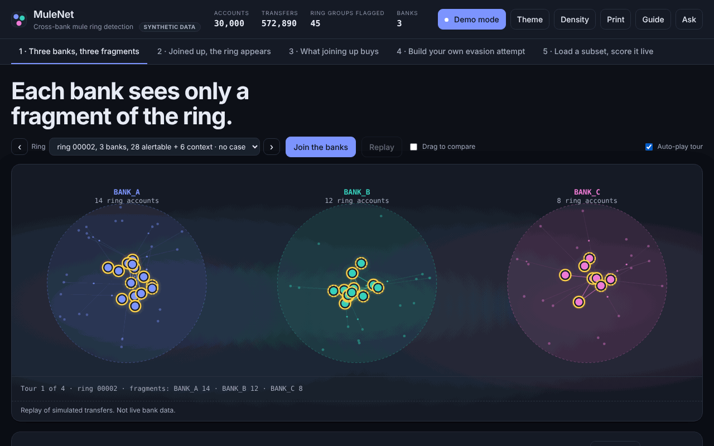
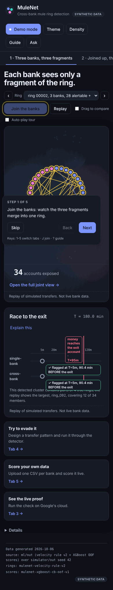
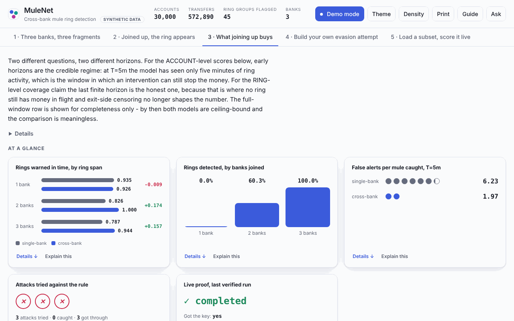

# ui

FastAPI backend plus the investigator-facing frontend, deployed on Cloud Run.
Owned by the **frontend-engineer** agent. Displays only hashed account IDs and
reads response models from `shared/`.

## Run it locally

```bash
python -m ui.build_snapshot                                  # once: builds ui/out/demo_snapshot.json
python -m uvicorn ui.main:app --reload --port 8080           # then open http://127.0.0.1:8080
python -m pytest ui/ -q
python -m ruff check ui/
```

The snapshot is derived transaction data and lands in `ui/out/`, which
`.gitignore` excludes. Rebuild it after `ml/` or `agents/` republish.
Deep links: `#banks`, `#joint`, `#metrics`.

## Tab 1 hero

Tab 1 opens on a canvas of the selected ring split across the three banks
(`static/hero.js`, `static/hero.css`). It draws only what `/api/rings/{id}`
already returns, shows no ground-truth label, and is captioned as a replay
of simulated transfers. The original bank tiles sit unchanged under
"Details". `prefers-reduced-motion` gets static frames instead of animation.

The hero opens on the ring that spans all banks and has the most accounts
(chosen from the loaded ring index, not hardcoded); tab 2 keeps its own
default. Hover or tap an account for a tooltip and detail panel, or use the
arrow keys and Enter. The simulator's truth label appears there only while
Reveal is on. "Auto-play tour" steps through the first few such rings once
and stops.

| Fragments | Joined | Tooltip |
|---|---|---|
|  |  |  |

| Side panel | Tour | Phone, dark, reduced motion |
|---|---|---|
|  |  |  |

## Tab 3 polish

`static/metrics.css` and `static/metrics-polish.js` restyle tab 3 without
changing what it says: a jump bar built from the section headings that are
on the page, the provenance line under a "Details" toggle, and wide tables
that scroll inside their own box. The script only rearranges the DOM that
`renderMetrics()` already produced, so tab 3's figures and text are
untouched and `app.js` is not modified for it.



## Where the data comes from

| Surface | Source |
|---|---|
| rings, members, membership basis | `ml/out/rings.parquet` |
| alert queues, member scores | `ml/out/scores.parquet` |
| ring narrative and factors | `ml/out/ring_explanations.parquet` |
| identity-reuse evidence | `ml/out/account_evidence.parquet` |
| cases (verified only) | `agents/out/cases.parquet` |
| transfer edges, accounts | `simulator/out/` |
| single-bank vs cross-bank metrics | `ml/experiments/early_detection/metrics.json` |

Ground truth from `simulator/out/ground_truth.parquet` is used for exactly one
thing: labelling which *alertable* accounts are really mules, so the demo
cannot flatter itself. It never drives detection or ring membership.

## Two things this UI refuses to do

**It never renders a lead as a finding.** `shared.contracts.Ring` carries a
`membership_basis` per member. `velocity` members are detections and draw as
solid discs. `identity_link` members are leads and draw dashed, with their
`reason` always shown. Same-bank links (`alertable == False`) are context
only: dotted, excluded from every count, never accused. `alertable` is read
from the row and never re-derived here.

**It never invents a case.** A case exists only where an investigation's
claims were re-derived from the data and matched. A ring with no row in
`agents/out/cases.parquet` renders "no case yet", and no STR is drafted
against it.

## Graph bounding

30,000 accounts and 572,890 transfers cannot go into Cytoscape. Per ring the
browser receives the members plus their 1-hop counterparties, capped at 90
nodes (`MULENET_UI_MAX_GRAPH_NODES`). Intra-ring edges are kept in full. The
money trail is what the demo animates, so truncating it would silently drop
hops, and context edges get a separate budget of 120, largest amount first.
Counterparties left with no surviving edge are dropped rather than drawn as
isolated dots. The toolbar states the counts actually rendered.

## Config

All via env vars in `ui/config.py`: `MULENET_READ_MODE`, `MULENET_BQ_PROJECT`,
`MULENET_BQ_DATASET`, `MULENET_BQ_TIMEOUT_S`, `MULENET_UI_SNAPSHOT`, `MULENET_DATA_DIR`,
`MULENET_UI_ML_OUT`, `MULENET_UI_AGENTS_OUT`, `MULENET_UI_METRICS`,
`MULENET_UI_METRICS_FALLBACK`, `MULENET_UI_CHAT_BACKEND`,
`MULENET_UI_AGENTS_URL`, `MULENET_UI_AGENTS_AUDIENCE`,
`MULENET_UI_AGENTS_TIMEOUT_S`, `MULENET_UI_AGENTS_AUTH`,
`MULENET_UI_MAX_GRAPH_NODES`, `MULENET_UI_GRAPH_HOPS`.

## Read modes

`MULENET_READ_MODE=snapshot` is the default and is what the demo runs on. The
snapshot is a local file, so the ring index costs ~0 ms.

`MULENET_READ_MODE=bigquery` puts the **ring index** on a BigQuery read path:
one query over `rings` joined to `transfers`, `account_evidence` and `cases`
derives the per-ring counts server-side instead of reading them out of the
file. `ui/bqrings.py` holds the statement and, per field, which
`build_snapshot.py` expression it restates. Nothing else moves, and the ring
detail, bank tiles and replay still come from the snapshot.

**Measured**, against `mulenet.mulenet` over 24 rings and 572,890 transfers:
85.4 MiB scanned, 86 MiB billed, **$0.00051 per cold query** at $6.25/TiB
on-demand; **~2.1-3.1 s cold**, ~1.5-3.2 s on BigQuery's 24-hour result cache
(0 bytes, nothing billed). The snapshot path is ~30 ms including the JSON
parse. **That seconds-scale floor is a real demo regression** and is the price
of the read path; the result is cached per process, so one page load is one
query and the demo-reset button re-queries.

**Six `RingSummary` fields are not derivable from that dataset** and come from
the snapshot even in `bigquery` mode. The payload and the page name all six,
so a ring row can never be read as wholly BigQuery-derived:
`cross_bank_transfer_count` (needs a hashed-account-id -> bank map; there is
no `accounts` table and the ids are HMAC digests),
`true_positive_alertable_members` (needs `ground_truth.parquet`, deliberately
not a BigQuery table), `true_ring_id` / `match_is_ambiguous` / `has_replay`
(from `ml/out/` parquet that is not loaded), and `detector_version`, which
is derivable from `rings.ring_id` but whose single definition
(`build_snapshot._detector_version_of`) sits behind a pandas import the
serving image omits, so re-deriving it here would mean a second copy of the
rule.

**On any failure (no credentials, API error, timeout, zero rows, or a ring
missing from the result) the snapshot answers and the page says so** in a
line above the tabs, worded `BigQuery unavailable - ring list read from file`
and naming the error and the file. Deliberately *not* the chat dock's
"offline demo mode": that means a keyword matcher answered instead of Gemini,
this means a file answered instead of a query, and one wording for both would
leave a judge unable to tell which happened.

**The metrics page is on files in both modes** and says so. There is no
metrics table in the dataset, so in `bigquery` mode the page carries an extra
line denying a BigQuery source, beside the `_provenance()` line that already
names the file actually opened.

## Chat

`MULENET_UI_CHAT_BACKEND=mock` is the default. The mock routes on intent and
answers from the loaded snapshot, so every number it states is one the graph
and case panel also show, and it labels itself `backend: "mock"`.

`MULENET_UI_CHAT_BACKEND=agents` calls the `agents/` Cloud Run service per
`docs/agents_api.md` (frozen contract) and requires `MULENET_UI_AGENTS_URL`.
That service has no public invoker access, so:

- `ui` mints a Cloud Run service-to-service **ID token** with the agents
  service as the audience (`MULENET_UI_AGENTS_AUDIENCE`, defaulting to the
  URL) and sends it as `Authorization: Bearer …`. A browser-supplied token is
  never forwarded; the identity is this server's.
- the agents URL is never rendered into a page or returned by an endpoint. The
  browser talks to `ui`; `ui` talks to `agents`.
- `session_id` is chosen by `ui`, not accepted from the browser: the contract
  says it is a rate-limit bucket key, and a caller free to pick it could reset
  the limit on every message.
- `MULENET_UI_AGENTS_AUTH=0` disables token minting, for a local fake agents
  service on a machine with no Google credentials.

**On any failure (error, timeout, unreachable, 429) the mock answers and the
page says so**, in the chat header pill and in a banner above the answer, with
distinct wording per case (`rate_limited` "going too fast" against `daily_cap`
"finished for today"). A silent fallback would let a judge believe they were
talking to Gemini when they were talking to a keyword matcher.
